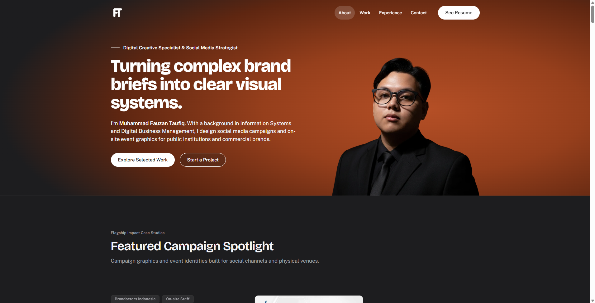

# **✨ Personal Portfolio Website (Dynamic Version)**

<strong>"Where Strategy Meets Aesthetic."</strong>

Website portofolio pribadi yang telah bertransformasi dari situs statis menjadi **Aplikasi Web Dinamis**. Ditenagai oleh **Supabase** sebagai Backend-as-a-Service (BaaS), memungkinkan pengelolaan konten (CMS) secara _real-time_ tanpa perlu mengubah kode sumber (source code) untuk setiap pembaruan konten.

🔗 **Live Demo:** [https://fauzantaufiq.id](https://fauzantaufiq.id)

## **🚀 Fitur Unggulan**

### **⚡ Backend & Dinamis (Baru)**

- **Supabase Integration:** Seluruh data (Portfolio, Pengalaman Kerja, Pendidikan, Skill) diambil secara dinamis dari database PostgreSQL.
- **Cloud Asset Storage:** Gambar dan dokumen PDF (CV) di-hosting di Supabase Storage, bukan lagi di folder lokal, membuat loading lebih cepat dan manajemen aset lebih mudah.
- **Database-Driven UI:** Seluruh komponen dirender berdasarkan data di database, memungkinkan update konten yang instan.
- **Dedicated Admin Dashboard:** Dilengkapi dengan panel admin kustom untuk mengelola konten secara langsung dengan UI/UX premium (termasuk secure login, password toggle, animated backgrounds, dan clean routing via Vercel).
- **Contact Form Database:** Pesan dari pengunjung langsung tersimpan ke tabel database messages, aman dan terpusat.

### **🎨 UI/UX Interaktif**

- **Smart Modal System:** Preview dokumen PDF dan galeri gambar (Lightbox) menggunakan logika deteksi tipe file otomatis.
- **Anti-Layout Shift:** Mekanisme penguncian scrollbar kustom untuk mencegah halaman "bergeser" saat modal dibuka.
- **Sliding Pill Navigation:** Navigasi bar dengan efek kapsul yang responsif.
- **Chameleon Scrollbar:** Warna scrollbar beradaptasi dengan tema bagian (Section) yang sedang dilihat.

## **🛠️ Teknologi yang Digunakan**

- **Frontend:**
  - HTML5 (Semantik)
  - Tailwind CSS (via CDN)
  - Vanilla JavaScript (ES6+)
- **Backend:**
  - **Supabase** (PostgreSQL Database)
  - Supabase Storage (File Hosting)
  - Supabase Auth (Row Level Security)

## **🗄️ Struktur Database (Schema)**

Proyek ini menggunakan tabel-tabel berikut di Supabase:

| Nama Tabel | Deskripsi |  
| portfolio_sections | Kategori utama portfolio (Header, Judul, Layout). |  
| portfolio_items | Item karya/gambar yang berelasi dengan section. |  
| competencies | Daftar skill (Creative Arsenal & Other) beserta ikonnya. |  
| education | Riwayat pendidikan. |  
| experience | Riwayat pengalaman kerja (mendukung fitur "Featured"). |  
| messages | Menyimpan pesan masuk dari Contact Form. |

## **💻 Cara Menjalankan di Lokal**

### **1\. Persiapan Awal**

Pastikan Anda memiliki akun [Supabase](https://supabase.com) dan buat proyek baru.

### **2\. Clone Repository**

git clone https://github.com/fauzantaufiq1211/fauzan-portfolio.git  
cd fauzan-portfolio

### **3\. Konfigurasi Database (SQL Setup)**

Buka menu SQL Editor di Dashboard Supabase Anda, lalu jalankan perintah SQL untuk membuat tabel.  
(Anda dapat meminta file setup_database.sql lengkap kepada pemilik repositori jika belum disertakan).

### **4\. Konfigurasi Storage**

1. Buat Bucket baru bernama static-assets dan portfolio-images.
2. Pastikan akses bucket diatur ke **Public**.
3. Upload aset gambar Anda ke bucket tersebut.

### **5\. Hubungkan API Key**

Buka file index.html, cari bagian konfigurasi Supabase, dan ganti dengan milik Anda:

const SUPABASE_URL \= "https://\[PROJECT-ID\].supabase.co";  
const SUPABASE_KEY \= "\[YOUR-ANON-PUBLIC-KEY\]";

### **6\. Jalankan Project**

Gunakan ekstensi **Live Server** di VS Code untuk menjalankan index.html.

## **⚙️ Cara Mengelola Konten (CMS)**

Terdapat dua cara untuk mengelola konten website:

### **1\. Melalui Admin Dashboard (Direkomendasikan)**

Akses halaman `/admin` (misalnya `https://fauzantaufiq.web.id/admin`) untuk masuk ke panel admin khusus. Anda dapat:

- Melakukan login aman terintegrasi dengan Supabase Auth.
- Melihat ringkasan dan statistik konten melalui Quick Navigation.
- Melakukan operasi CRUD (Create, Read, Update, Delete) untuk Portfolio, Experience, Education, dan Competencies melalui antarmuka yang modern.

### **2\. Melalui Supabase Table Editor**

Anda juga dapat membuka **Table Editor** di Dashboard Supabase untuk akses data mentah:

- **Tambah Portfolio:** Isi tabel portfolio_items dan hubungkan dengan section_id yang sesuai.
- **Update Experience:** Tambah baris di tabel experience. Centang is_featured untuk menandakan "Featured".
- **Ganti CV:** Upload file PDF baru ke Storage, lalu update link di tabel/kode terkait.

## **🤝 Contact**

**Muhammad Fauzan Taufiq**

- 📍 Digital Creative Specialist & Social Media Strategist
- 📧 Email: [fauzantaufiq1211@gmail.com](mailto:fauzantaufiq1211@gmail.com)
- 💼 LinkedIn: [linkedin.com/in/fauzantaufiq](https://linkedin.com/in/fauzantaufiq)
- 📷 Instagram: [@fauzan.taufiqq](https://instagram.com/fauzan.taufiqq)

Dibuat dengan ❤️, ☕, dan kekuatan Cloud Database.

